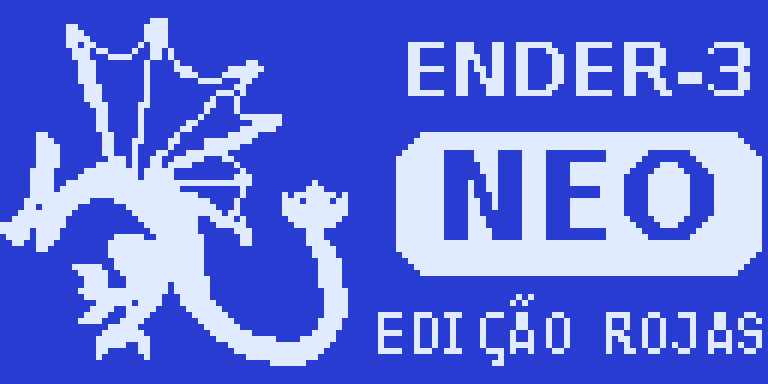
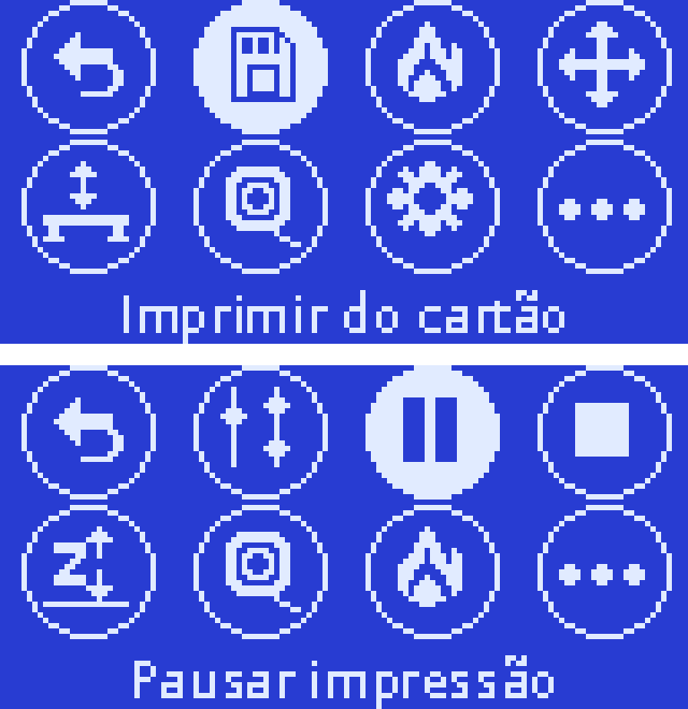

# Ender-3 Neo: firmware Edição Rojas + bootloader por cartão SD

Firmware e bootloader para a **Creality Ender-3 Neo** (placa CR-FDM v4.2.2, chip GD32F303RET6 / STM32F103RE, CR Touch, display 12864).

Base: [E3NeoCFW](https://github.com/BenjyEX3/E3NeoCFW) V05, sobre o [Marlin](https://github.com/MarlinFirmware/Marlin) 2.1.2.

<p align="center">
  
  &nbsp;
  
</p>

## Destaques

### Bootloader genérico por cartão SD
Bootloader escrito do zero para a placa v4.2.2 ([`bootloader/`](bootloader/)). Ele ocupa só 3,8 KB dos 28 KB reservados e usa o mesmo layout da Creality: bootloader em `0x08000000`, firmware em `0x08007000`.

- Lê o cartão pelo SDIO, em FAT16 ou FAT32, e procura um `.bin` na raiz.
- **Não precisa renomear o arquivo** a cada atualização. Ele compara o arquivo com a flash e só grava se for diferente.
- **Nunca escreve no cartão.**
- Recusa arquivos que não são firmware para `0x08007000`: compilados para `0x08000000`, grandes demais ou lixo do macOS.
- Grava a tabela de vetores por último. Se faltar energia no meio, ele tenta de novo no próximo boot.
- Avisa pelo buzzer: 2 bipes = gravou, 1 longo = erro, 1 bipe a cada 3 s = sem firmware válido.
- Útil para quem trocou o chip da placa ou perdeu o bootloader original.

### Interface em português
- Tradução pt-BR completa: todo texto que ainda saía em inglês nesta configuração foi traduzido.
- Revisão das traduções existentes, por exemplo "Arrancada" → "Jerk", "Compensar Sonda em Z" → "Z-offset sensor" e "Superior Direto" → "Superior Direito".

### Menu principal em grade (estilo smartwatch)
- 8 bolhas com ícones em 2 linhas. Gire o botão para escolher e clique para abrir.
- As bolhas mudam conforme o estado da impressora: parada, imprimindo ou pausada.
- "Mais opções" leva ao menu em lista completo do Marlin, então nada foi removido.
- Pode ser desativado em `Configuration_adv.h` (`MAIN_MENU_GRID`).

### Recursos de assistência ao nivelamento
A bolha **Nivelamento** reúne tudo num lugar:

| Item | O que faz |
|---|---|
| Nivelar e salvar | Home, malha 5×5 com o CR Touch, liga o nivelamento e salva. Um clique. |
| Assistente Z-offset | Mede a mesa e guia o ajuste do bico com papel |
| Ajuste fino do Z | Ajusta o Z-offset ao vivo, inclusive durante a impressão |
| Assistente de cantos | Mede os 4 cantos com o sensor e diz quanto girar cada botão da mesa |
| Nivelar cantos (papel) | O método manual tradicional |

Correções que atrapalhavam o nivelamento:
- O nivelamento **desligava a cada home**. Agora continua ligado depois do `G28`.
- O assistente de cantos **calculava voltas para parafuso M3**. A Ender-3 usa M4, então corrigido.
- Cada ponto é medido duas vezes (rápido e depois lento) para mais precisão.

### Estabilidade e segurança
| Antes | Agora | Motivo |
|---|---|---|
| Sensor em modo de alta velocidade | Modo normal | Leituras falhas e "Probing failed" |
| Sensor descendo a 20 mm/s | 6 mm/s | Medições mais confiáveis |
| Z até 20 mm/s, aceleração 500 | 10 mm/s, aceleração 200 | O fuso perdia passos |
| Temperatura mínima 0 °C | 5 °C | Detecta termistor solto mais rápido |
| Proteção térmica da mesa 180 s | 60 s | Menos tempo aquecendo sem controle |
| Sensor de filamento compilado | Removido | O Neo não tem sensor |
| Ordenação de arquivos em RAM dinâmica | Sem cache | Evita falta de memória com pastas grandes |
| SWD desligado pelo Marlin | **SWD sempre ativo** | O ST-Link conecta com a impressora ligada |
| "Falha ao ler cartão" ao retirar o cartão | Corrigido | Debounce do contato de detecção do cartão |

Também ganhou PID editável e autoajuste de PID pelo menu, duplo clique na tela inicial para o ajuste fino do Z e uma nova arte de boot com um dragão em pixel art.

## Arquivos prontos ([`binarios/`](binarios/))

| Arquivo | Uso |
|---|---|
| `neo-completo-bootloader+firmware-0x08000000.bin` | Bootloader + firmware. Grave com ST-Link em `0x08000000`. |
| `neo-firmware-0x08007000.bin` | Só o firmware. Copie para o cartão SD (com o bootloader) ou grave em `0x08007000`. |
| `neo-stub-1k-0x08000000.bin` | Alternativa sem bootloader. Grave em `0x08000000` junto com o firmware em `0x08007000`. |

### Primeira gravação (ST-Link)
1. Ligue o ST-Link V2 na placa: SWDIO, SWCLK e GND. O 3.3V é opcional.
2. No STM32 ST-LINK Utility: *Connect*, abra `neo-completo-bootloader+firmware-0x08000000.bin`, *Program & Verify* em `0x08000000`.
3. Se a placa estiver com um firmware que desliga o SWD, use *Connect Under Reset* (pino NRST) ou clique em *Connect* e ligue a impressora logo em seguida.

### Atualizações seguintes
Copie `neo-firmware-0x08007000.bin`, com qualquer nome, para a raiz de um cartão FAT32 e ligue a impressora.

### Depois de instalar
1. *Configuração → Config. Avançada → Iniciar EEPROM*
2. *Nivelamento → Assistente Z-offset*
3. *Nivelamento → Nivelar e salvar*

## Compilar

**Firmware** ([`firmware/`](firmware/)): árvore completa do Marlin 2.1.2 com as modificações. Abra no VS Code com PlatformIO e compile o ambiente `STM32F103RE_creality`, que já é o padrão. Prefira sempre uma compilação limpa, porque o PlatformIO não detecta mudanças nos arquivos de idioma.

**Bootloader** ([`bootloader/`](bootloader/)): precisa do `arm-none-eabi-gcc`.
```
make          # gera build/bootloader.bin
make test     # testes no PC com imagens de cartão (Linux, mtools + dosfstools)
```

**Ícones e arte** ([`ferramentas/`](ferramentas/)): `icons.py` gera os ícones do menu, `bootart.py` gera a tela de abertura a partir de `dragao.png` e `preview.py` gera a prévia do menu.

## Arquivos alterados no Marlin
- `Marlin/Configuration.h`, `Marlin/Configuration_adv.h`
- `Marlin/_Bootscreen.h` (arte de boot)
- `Marlin/src/lcd/menu/menu_main.cpp` e `menu_main_grid.inc` (menu em grade e nivelamento)
- `Marlin/src/lcd/dogm/grid_icons.h` (ícones 16×16)
- `Marlin/src/lcd/language/language_pt_br.h` e `language_en.h`
- `Marlin/src/pins/stm32f1/pins_CREALITY_V4.h` (SWD ativo)
- `Marlin/src/sd/cardreader.cpp` (debounce do cartão)

## Aviso
Use por sua conta e risco. Antes de atualizar, anote seu Z-offset e tenha um ST-Link à mão para recuperar a placa se algo der errado.

## Licença
GPL-3.0, a mesma do Marlin. Créditos ao time do Marlin e ao autor do E3NeoCFW.
